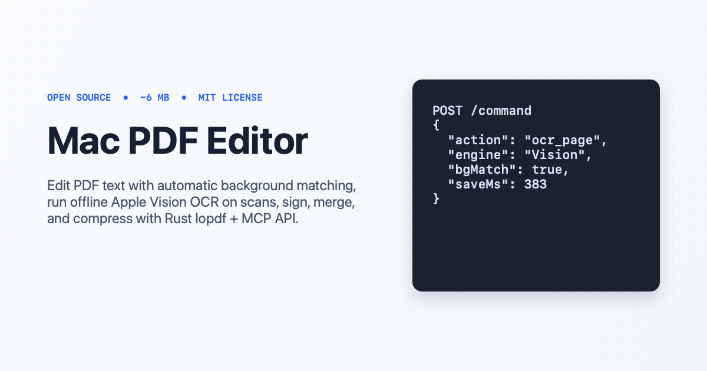

# Mac PDF Editor — Free Open-Source PDF Editor for macOS, Windows & Linux (Offline OCR & MCP API)

[](https://github.com/document-software/mac-pdf-editor/actions/workflows/build.yml)
[](./LICENSE)
[](https://document-software.github.io/mac-pdf-editor/)



> **A lightweight (~6 MB), privacy-first desktop PDF editor** built with **Tauri v2 (Rust)**, **React + TypeScript**, **PDF.js**, **pdf-lib**, **lopdf**, and **macOS Vision OCR**. A fast, free open-source alternative to **Adobe Acrobat Pro**, **PDF Expert**, and **Apple Preview**.

🌐 **Official Website & Guides:** [https://document-software.github.io/mac-pdf-editor/](https://document-software.github.io/mac-pdf-editor/)

---

## Why Mac PDF Editor?

| Feature | Mac PDF Editor (OSS) | Apple Preview | Adobe Acrobat Pro | PDF Expert |
| :--- | :--- | :--- | :--- | :--- |
| **Price** | **Free (MIT)** | Built-in (macOS) | $19.99–$29.99/mo | $79.99/yr |
| **Edit Existing Text + Background Match** | **Yes** | No | Yes | Pro only |
| **Offline OCR for Scanned PDFs** | **Yes (Apple Vision)** | Copy only | Yes | Pro only |
| **Cross-Platform (macOS / Win / Linux)** | **Yes** | macOS only | Win / macOS | Apple only |
| **AI Agent Automation (MCP + HTTP API)** | **Yes (Built-in)** | No | No | No |
| **Binary Size** | **~6 MB** | System | 1+ GB | ~150 MB |

---

## Key Capabilities & Feature Pages

- ✏️ **[Edit Existing PDF Text](https://document-software.github.io/mac-pdf-editor/features/edit-pdf-text.html)** — Highlights all editable text blocks in **Text (`T`)** mode, matches input box dimensions to the original text run, and automatically samples surrounding canvas pixels (`sampleBackgroundColor`) so replacements blend seamlessly without harsh white patches. Full Unicode & Cyrillic support.
- 🔍 **[Offline macOS Vision OCR](https://document-software.github.io/mac-pdf-editor/features/macos-vision-ocr.html)** — One-click text recognition for scanned PDFs using Apple's native `VNRecognizeTextRequest` (EN + RU), turning flat scans into clickable, editable text blocks with zero cloud uploads.
- 📄 **[Merge, Split, Rotate & Compress PDF](https://document-software.github.io/mac-pdf-editor/features/merge-split-compress-pdf.html)** — Reorder, duplicate, delete, extract single pages, merge multiple PDFs, rotate `90°` with aligned annotations, and compress via Rust `lopdf` (`prune_objects` + `compress`).
- 🖊️ **[Annotate, Highlight, Whiteout & Sign](https://document-software.github.io/mac-pdf-editor/features/annotate-sign-pdf.html)** — Translucent highlights (`H`), rectangles & whiteout redaction (`R`), freehand vector signatures (`D`), PNG/JPG stamp insertion with resize handles, and PNG export with annotations.
- 🤖 **[MCP Server & HTTP Control API](https://document-software.github.io/mac-pdf-editor/features/mcp-http-api.html)** — Built-in HTTP API (`http://127.0.0.1:4890`) and stdio MCP server ([`mcp/server.mjs`](./mcp/server.mjs)) for Claude Desktop, Cursor, and Antigravity.

---

## Guides & Comparisons

- 📖 **[How to Edit a Scanned PDF on Mac (Free Offline OCR Guide)](https://document-software.github.io/mac-pdf-editor/guides/how-to-edit-scanned-pdf-mac.html)**
- ⚖️ **[Free Open-Source Alternative to Adobe Acrobat & PDF Expert](https://document-software.github.io/mac-pdf-editor/compare/adobe-acrobat-alternative.html)**
- 🏗️ **[Technical Architecture & How It Works](./docs/HOW_IT_WORKS.md)**

---

## Local Development & Build

Requirements: Node.js 20+, Rust (`rustup`), Xcode Command Line Tools (on macOS).

```bash
npm install
npm run tauri dev
```

Build a production `.app` / `.dmg` / `.msi` / `.AppImage`:

```bash
npm run tauri build
```

## Run the 20-Task Automated Test Suite

With `Mac PDF Editor` running:

```bash
node tests/run_20_tasks.mjs
```

## License

[MIT License](./LICENSE) © 2026 [document-software](https://github.com/document-software)
