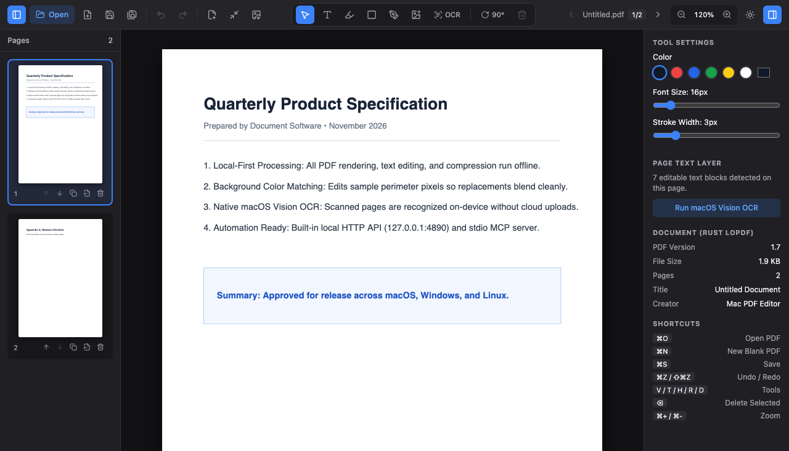

# Mac PDF Editor: Open-Source PDF Editor for macOS, Windows, and Linux

[](https://github.com/document-software/mac-pdf-editor/actions/workflows/build.yml)
[](./LICENSE)
[](https://document-software.github.io/mac-pdf-editor/)



Mac PDF Editor is a 6 MB desktop PDF editor built with Tauri v2 (Rust), React, TypeScript, PDF.js, pdf-lib, lopdf, and macOS Vision OCR. Everything runs locally on your machine with no cloud uploads or subscription fees.

Official website and guides: [https://document-software.github.io/mac-pdf-editor/](https://document-software.github.io/mac-pdf-editor/)

## Comparison

| Feature | Mac PDF Editor (OSS) | Apple Preview | Adobe Acrobat Pro | PDF Expert |
| :--- | :--- | :--- | :--- | :--- |
| **Price** | **Free (MIT)** | Built-in (macOS) | $19.99 to $29.99/mo | $79.99/yr |
| **Edit Existing Text + Background Match** | **Yes** | No | Yes | Pro only |
| **Offline OCR for Scanned PDFs** | **Yes (Apple Vision)** | Copy only | Yes | Pro only |
| **Cross-Platform (macOS, Win, Linux)** | **Yes** | macOS only | Win / macOS | Apple only |
| **AI Agent Automation (MCP + HTTP API)** | **Yes (Built-in)** | No | No | No |
| **Binary Size** | **~6 MB** | System | 1+ GB | ~150 MB |

## Features

- **[Edit Existing PDF Text](https://document-software.github.io/mac-pdf-editor/features/edit-pdf-text.html)**: Highlights editable text blocks in Text (`T`) mode, sizes the input box to the original text run, and samples surrounding pixels (`sampleBackgroundColor`) so replacements match the page background instead of leaving white patches. Supports Unicode and Cyrillic.
- **[Offline macOS Vision OCR](https://document-software.github.io/mac-pdf-editor/features/macos-vision-ocr.html)**: Recognizes text on scanned pages using Apple's `VNRecognizeTextRequest` (English and Russian) and turns scans into clickable, editable blocks.
- **[Merge, Split, Rotate, and Compress PDF](https://document-software.github.io/mac-pdf-editor/features/merge-split-compress-pdf.html)**: Reorder, duplicate, delete, or extract single pages, merge multiple PDFs, rotate pages by `90°` while keeping annotations aligned, and compress files with Rust `lopdf` (`prune_objects` and `compress`).
- **[Annotate, Whiteout, and Sign](https://document-software.github.io/mac-pdf-editor/features/annotate-sign-pdf.html)**: Add translucent highlights (`H`), rectangles and whiteout cover boxes (`R`), freehand signatures (`D`), resizable PNG or JPG stamps, and export annotated pages to PNG.
- **[MCP Server and HTTP Control API](https://document-software.github.io/mac-pdf-editor/features/mcp-http-api.html)**: Control the running app from scripts or AI assistants (Claude Desktop, Cursor, Antigravity) over `http://127.0.0.1:4890` or the stdio MCP server in [`mcp/server.mjs`](./mcp/server.mjs).

## Guides and Architecture

- [How to Edit a Scanned PDF on Mac](https://document-software.github.io/mac-pdf-editor/guides/how-to-edit-scanned-pdf-mac.html)
- [Open-Source Alternative to Adobe Acrobat and PDF Expert](https://document-software.github.io/mac-pdf-editor/compare/adobe-acrobat-alternative.html)
- [Technical Architecture and How It Works](./docs/HOW_IT_WORKS.md)

## Local Development and Build

Requires Node.js 20+, Rust (`rustup`), and Xcode Command Line Tools on macOS.

```bash
npm install
npm run tauri dev
```

Build a production `.app`, `.dmg`, `.msi`, or `.AppImage`:

```bash
npm run tauri build
```

## Automated 20-Task Test Suite

With `Mac PDF Editor` running:

```bash
node tests/run_20_tasks.mjs
```

## License

[MIT License](./LICENSE) © 2026 [document-software](https://github.com/document-software)
